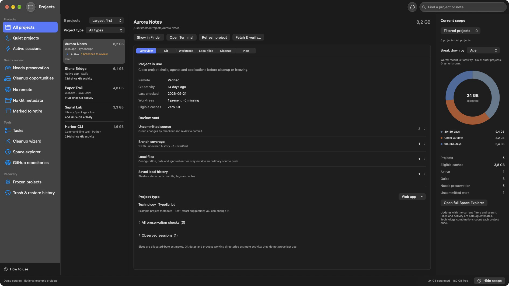
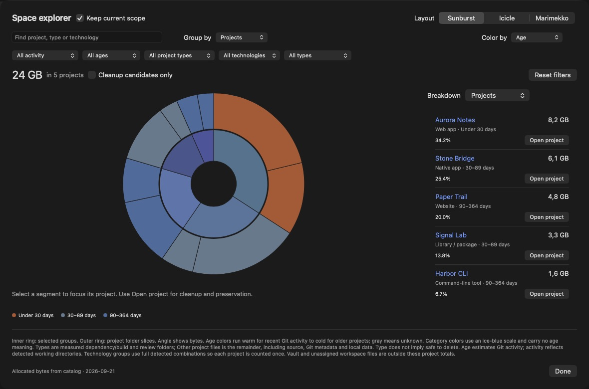
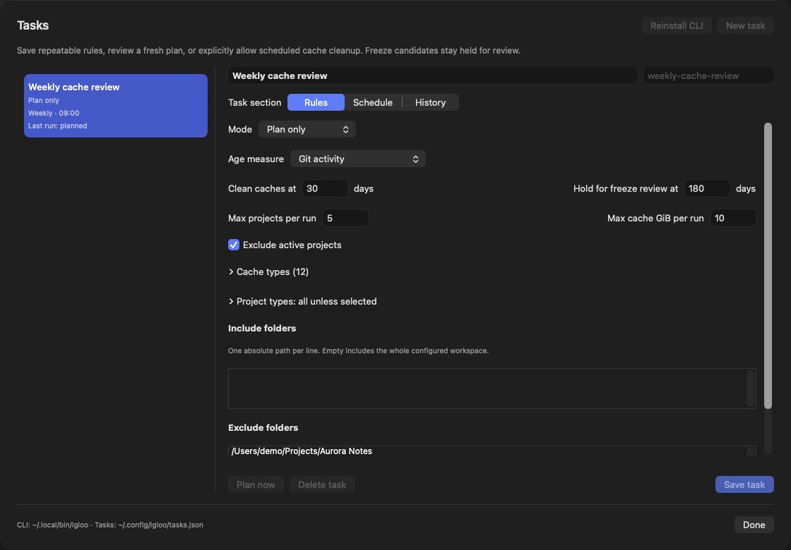

# Igloo


Projects pile up. Dependencies grow, experiments go quiet, and it gets harder to remember which folders contain work you haven't pushed.

Igloo is a native macOS app that helps you sort it out. See what's taking up space, clean up files you can rebuild, and freeze projects you want to come back to later.



## What you can do

- Find large, inactive projects and explore disk use by age, project type, technology, or folder type.
- Review uncommitted changes, unpushed branches, worktrees, stashes, and local files before cleaning up.
- Remove old dependencies and caches, with a preview first and recovery through Trash.
- Freeze a project: preserve local files, push reviewed source, and remove the checkout after verification. Thaw it when you want to work on it again.
- Connect Git remotes, create private GitHub repositories, commit selected files, and browse or clone your repositories.
- Use the cleanup wizard to keep recent projects, clean older ones, and propose freezing projects past a second age threshold.
- Save tasks, run them with the `igloo` CLI, and schedule daily or weekly reviews or cache cleanup.

You choose the rules and review the plan. Scheduled cleanup needs your explicit permission; projects that need freezing stay held for review.



[Website and downloads](https://tm-henningnt.github.io/Igloo/) · [Published releases](https://github.com/tm-henningnt/Igloo/releases)

## Get started

You'll need macOS 14 or later, Git, and the GitHub CLI (`gh`) for GitHub features. The standard app includes its own private Python runtime.

Open the DMG and drag Igloo to Applications, open **Settings**, and choose your projects folder. Then click **Analyse Projects**. A scan gives you a starting point without changing your projects.

This release is not notarized or signed with Apple Developer ID. If macOS blocks the first launch, try opening Igloo, then go to **System Settings → Privacy & Security → Open Anyway** to approve this app. See [Apple’s instructions](https://support.apple.com/en-us/102445).

Open **How to use** in the app, or read the [user guide](docs/guide.md), for cleanup, freezing, and recovery.

## CLI and scheduling

Choose **Tasks → Install CLI** in the app. You can then save a task and generate a plan from Terminal:

```sh
igloo create weekly-review --cache-days 45 --freeze-days 180
igloo plan weekly-review
```

Set a daily or weekly schedule in the app or CLI. Start with a review task, then allow automatic cache cleanup when you're happy with its scope and limits.

[Tasks, CLI, and scheduling guide](docs/tasks.md)



## Updates

Choose **Igloo → Check for Updates** to check published releases and download a verified update. A smaller system-Python build is also supported for people who maintain Python 3.11 or later themselves. Updates keep your chosen variant.

## Keep your recovery files safe

Local files such as ignored configuration stay in a local archive when you freeze a project. Keep a separate backup of those archives: they are not uploaded to GitHub or encrypted. Reinstall dependencies after thawing.

## Contributing

Found a bug or have an idea? [Open an issue](https://github.com/tm-henningnt/Igloo/issues). Pull requests are welcome; see [Contributing](CONTRIBUTING.md) and the [development guide](docs/development.md) for builds and tests.

## License

Igloo is source-available under the [Sustainable Use License 1.0](LICENSE). You can use and modify it for personal, noncommercial, or internal business purposes for free. Sharing copies or modified versions is allowed only free of charge for noncommercial purposes; selling repackaged versions or charging for access requires separate permission. The full license governs these permissions.
