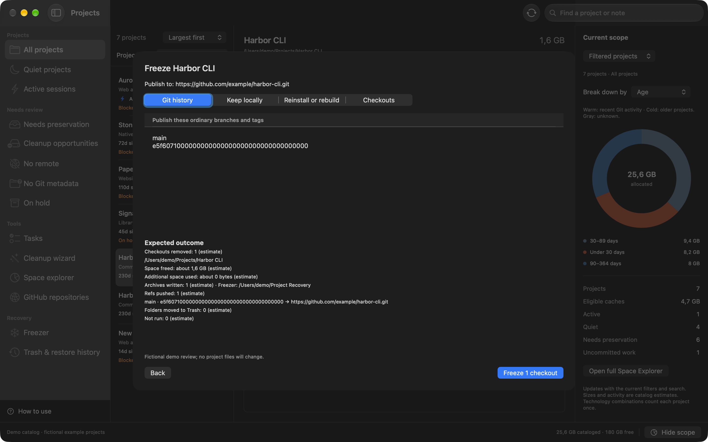
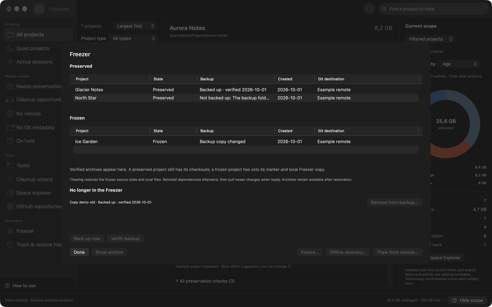

# Using Igloo

Start by choosing your projects folder in **Settings**, then click **Analyze Projects**. Igloo looks for projects and Git repositories, checks their local state, and estimates how much disk space they use. Scanning does not change project files.

## First launch

The current release is not notarized or signed with Apple Developer ID. Open the DMG and drag Igloo to Applications. If macOS blocks it, try opening the app, then approve Igloo in **System Settings → Privacy & Security → Open Anyway**. See [Apple’s instructions](https://support.apple.com/en-us/102445). macOS may ask for approval again after an update.

## Find a place to start

The project list can show quiet projects, active sessions, cleanup opportunities, or projects with work to preserve. Search by name or technology, filter by project type, and sort by size or age. A blocker badge appears when a quick check finds a missing requirement; open the project's Preservation tab to resolve it.

Select a project to see its overview. The Git, Worktrees, Local files, and Cleanup tabs let you look more closely at anything that needs attention. Igloo suggests project types from their files; you can correct a suggestion in Overview.

The scope panel on the right follows your current filters. Open **Space Explorer** for a larger view with sunburst, icicle, and Marimekko charts. Warm age colors mean recent Git activity, cold colors mean older work, and gray means unknown. Disk figures are estimates, so the amount reclaimed may differ.

## Clean up dependencies and caches

Open a project's **Cleanup** tab, select the folders you want to remove, and review the proposed changes. Igloo rechecks the selection before moving it to Trash. Use **Trash & restore history** if you need to restore it.

Check for custom changes before removing dependencies you normally regenerate. Active projects and folders containing tracked files or local configuration can stop cleanup and require review.

For a larger cleanup, open **Cleanup wizard**:

1. Choose how to measure age: Git activity or source-file modification time.
2. Set a cleanup age and a later freeze age.
3. Scan, then adjust the proposed action for each project.
4. Review the folders, Git destinations, local archives, and checkout removals.
5. Accept the review to run its ready actions.

Projects younger than the first threshold stay as they are. Between thresholds, Igloo proposes cache cleanup. Past the second threshold, it proposes Freeze for your Review. Active sessions and unknown age or activity stay unchanged by default. Igloo checks again for terminals, agents, and applications using a project before it prepares or runs cleanup or Freeze; close them first.

The results show what completed, stopped, or failed. If something changes during the run, inspect the result and make a fresh Review for the remaining work.

## Preserve work before putting a project away

Use the **Git** tab to review changes, branches, stashes, and remotes. The **Local files** tab helps you spot ignored configuration and data that an ordinary push would leave behind.

In **Preservation**, you can connect an existing remote or create a private GitHub repository. Choose the GitHub account or organization explicitly. You can also review and commit selected source files. Commit source changes before freezing, and check committed history before publishing it.

Use the **Hold** switch to stop the wizard and tasks from proposing cleanup or freezing for a project. The **On hold** filter finds held projects. Manual cleanup, Preserve and Freeze remain available and show a Hold warning in their reviews. Preservation notes stay with the project.

If a new Git repository has no files that Igloo can commit, add a source file and make an initial commit. The checklist offers Finder and Terminal as next steps.

## Freeze a project

Freezing is for projects you want to keep but no longer need on disk as a working checkout.

1. Commit the source changes you want to keep and close applications or terminals using the project.
2. Choose **Preservation → Freeze**. The Requirements checklist shows blockers and, where available, actions to fix them. A remote and committed source are required. Choose a publish destination, then **Build review**.
3. Review the branches and tags to publish, local files to keep, folders to reinstall or rebuild, and affected checkouts. The outcome summary shows the expected recovery sets, refs, checkout removals, and estimated space.
4. Accept the action in the Review once. Igloo creates local recovery archives, tests restoration, pushes the reviewed source, verifies it remotely, and then removes the reviewed checkouts. If verification or removal cannot finish, inspect the result in **Freezer**.

Choose **Preserve** when you want the same recovery and publication steps while keeping the checkout.

The wizard can complete the full freeze, including checkout removal, when you accept that action in its review.

Ignored local files, stashes, and other local Git state stay in your recovery archives. Rebuildable folders such as node_modules can be left out. Review the omissions, especially if you've edited dependencies locally.

## Thaw a project

Open **Freezer**, select the project, and choose **Thaw from remote**. Igloo restores the frozen source state, local files, and worktrees. **Offline recovery** uses the local recovery copy when you don't have remote access.

Existing destination files are never overwritten. Reinstall dependencies afterward, then pull newer remote changes when you're ready. Keep the archive until you're satisfied everything you need is back.

## Bring another repository onto your Mac

Open **GitHub repositories** to browse your account or an organization. You can hide repositories already cloned locally, select several, and review their destination folders before cloning. Existing folders are left untouched.

Run **Analyze Projects** afterward to add the clones to your project list.

## Repeat the routine

Save a task for rules you want to reuse. Tasks can prepare fresh Reviews or clean matching caches within your chosen limits. Daily and weekly schedules are optional; automatic cleanup needs explicit permission.

See [Tasks, CLI, and scheduling](tasks.md) for examples.

## Updating Igloo

Choose **Igloo → Check for Updates** from the app menu or About screen. Igloo checks published releases, shows formatted release notes, and downloads the version for your Mac and runtime choice. Only HTTPS links in release notes open.

If a check or download fails, the update window explains the problem and links to the published releases. If GitHub's request limit is exhausted, wait until the displayed UTC reset time, when available, before trying again. For an offline connection or timeout, check your connection; for a denied request or server error, try again later. Igloo does not retry automatically.

After the checksum has been verified, choose **Show in Finder**. Open the ZIP, quit Igloo, and move the new app into Applications. Your projects, settings, and local archives stay where they are. If you use the CLI, choose **Tasks → Reinstall CLI** after updating.

The standard app keeps its own Python inside the app bundle and leaves your system Python and PATH alone. The optional System Python build uses the Python installed on your Mac (Python 3.11 or later); its path can be changed in Settings.

## Settings and backups

Settings are stored in `~/.config/igloo`. Catalogs, history, and other app data default to `~/.igloo`, with recovery archives in `~/.igloo/vault`. You can choose different storage locations in Settings.

Archives stay on your Mac and are not encrypted. A remote repository alone does not preserve your ignored files or all local Git state.

Changing a storage location selects another folder; it does not move existing archives for you. Keep the previous location until you've moved and checked anything you still need.

### Freezer backup

In **Settings**, choose a **Freezer backup folder** from detected external disks and cloud storage, or choose another folder, then save settings. Select **None** to turn backup off. Igloo keeps copies in a private `Igloo-Freezer-Backup` subfolder. After each Preserve it copies the new archive and checks SHA-256 checksums. If the folder is disconnected or cannot be written, Preserve still succeeds and the archive shows **Not backed up**, with a reason. Reconnect the folder and choose **Back up now** in Freezer to retry; **Verify backup** checks existing copies again.

For iCloud Drive or a folder under `~/Library/CloudStorage`, Igloo asks you to confirm that local-only files will upload **unencrypted**. Confirmation applies to the chosen destination; choosing a different cloud folder needs a new confirmation. The former global `freezerBackupCloudAccepted` flag grants no consent. Igloo does not encrypt these copies.

The backend commands are `backup-run`, `backup-verify`, `backup-status`, and `backup-remove <copy-id>` (arguments to `backend/organizer.py`). `backup-verify` reads every copy again, compares recovery checksums, and records its last successful verification time. The copied lifecycle manifest remains a snapshot of when the archive was backed up. `backup-status` lists each archive's backup state and copies no longer in the Freezer. A nonempty `error` means status discovery failed or the configured destination is unavailable; an unreadable Freezer is not reported as a healthy empty backup. Status reflects the latest verification; run `backup-verify` to check the bytes again.

The `backup-status` JSON contains `configured`, `available`, `reason`, `cloud`, `acceptanceRoot`, and `cloudAccepted`, plus `archives` and `orphans` arrays. Each row contains `id`, `copyID`, `backedUp`, `lastVerified`, `missing`, `status`, and `reason`; `lastVerified` is null until verification. An optional `error` describes a failed status lookup or unavailable destination. The `acceptanceRoot` identifies the resolved destination and is saved in `freezerBackupCloudAcceptedRoot` after cloud confirmation. Treat these paths and archive identifiers as private.

Backup only adds copies. Thawing or removing an archive leaves its backup intact. In Freezer, use **Remove from backup** to remove a copy explicitly after it is no longer in the Freezer. An existing copy is never overwritten, even if verification fails; keep it for recovery and investigate the reported reason.
